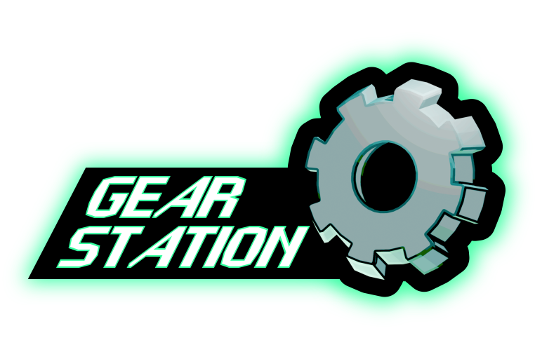

  

# Gear Station
Space-Station 14

Gear Station is STARLIGHT fork focused on admin involvement to create interesting stories.

---
STARLIGHT is an open source project aimed at creating unique mechanics and a pleasant game atmosphere in Space Station 14, a game about survival on a space station where there are constant confrontations between the crew and antagonists created to prevent the crew from achieving their goals.

## Developer Documentation
Gear Station's contributor guidelines are still in the making.

The [Starlight Developer Documentation](https://docs.starlight.network/s/d49865f5-b555-4803-b5d7-5c2fde54fbd9/doc/developer-guides-Hf0UsFaugc) contains useful documents and resources on getting started with this repository.

Space-Station 14 has [docs site](https://docs.spacestation14.io/) documentation on SS14s content, engine, game design and more. They also have lots of resources for new contributors to the project.

## AI-generated contributions disclaimer

This project does not accept wholesale AI-generated contributions. Due diligence for quality assurance, cleanup, and verification is the responsibility of the contributor. Any submission that is low quality and has not seen this due diligence will be rejected outright.

Any contributions that use artificial intelligence for generating content visible by the player will be rejected immediately.

The use of assistant tools such as an IDE's autocomplete, debuggers or AI parsing of large amounts of data and error logs, etc is always acceptable. Make sure to fact check any information and use common sense.

## License

> [!NOTE]
> **Relicensing in progress.** The Starlight Fork License (`LICENSE-Starlight.TXT`) was applied to Starlight contributions
> from **2024-11-04** (commit `84205e38`) through **2026-02-28** (commit `01eff0f7`).
> This license **remains in effect** for contributions made during that period until explicit relicensing
> consent is received from the respective authors. Once consent is given, those contributions are relicensed under MIT.
> All contributions outside of that range are licensed under MIT (`LICENSE.TXT`).
> Relicensing requests are tracked in [issue #3499](https://github.com/ss14Starlight/space-station-14/issues/3499).

### Click each banner for further information

>Some files are licensed under [MIT license](https://opensource.org/license/MIT), these files are Space Wizards Federation code.

>All other non-code STARLIGHT Assets, including icons and sound files, are licensed under the [Creative Commons 3.0 BY-SA](https://creativecommons.org/licenses/by-sa/3.0/) license unless otherwise noted in the folder or file.

